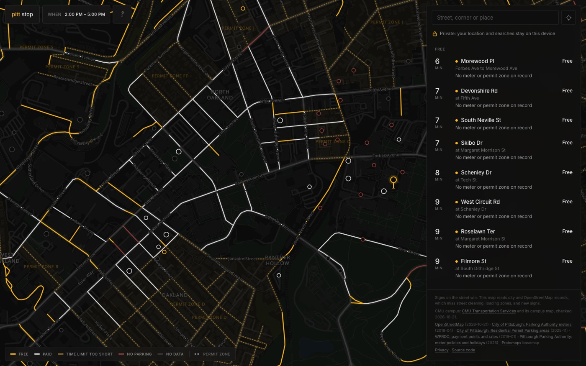
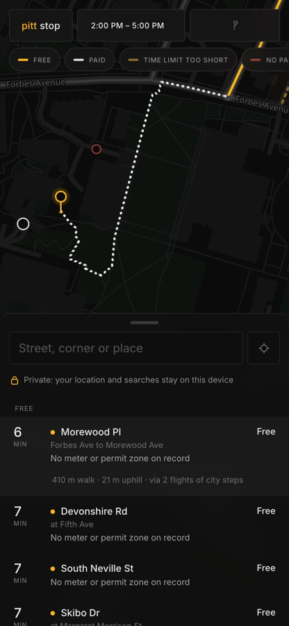
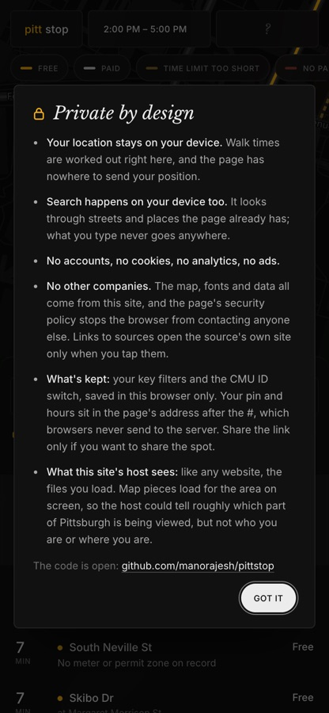

# pitt stop

[](https://github.com/manorajesh/pittstop/actions/workflows/ci.yml)
[](LICENSE)
[](https://mano.raje.sh/pittstop/)
[](#privacy)

Free and paid parking in Pittsburgh, ranked by walking time, for the hours you actually need it.



<p>
  
  
</p>

## Features

- **Drop a pin, get a list.** The nearest free spots by walking time, with hills and city steps counted. Paid options show the cost for your window.
- **Rules that depend on time.** Meters, permit-zone visitor limits, rush-hour no-parking and Parking Authority holidays are all checked against your *from–to* hours.
- **Every kind of parking.** Free, paid, time-limited, no parking and lots or garages. Click the key to filter.
- **CMU campus, checked by hand.** Garage tariffs, the Morewood lot, permit-only lots and the campus meter streets. Each one links to its CMU or Parking Authority source.
- **Built for phones.** Draggable bottom sheet, optional "near me", 44 px tap targets, fast on a mid-range phone.

## Privacy

Nothing leaves your device.

- Location is optional, used only when you ask, and never sent anywhere.
- Search runs in the browser against data the page already has.
- No accounts, cookies, analytics or third parties. Map tiles, fonts and data are self-hosted, and a strict [Content Security Policy](index.html) blocks every other origin.
- Preferences live in `localStorage`. The pin and hours sit in the URL fragment, which browsers never send to the server.

## How it works

```
pipeline/ (Python)                         public/ (static)               src/ (Preact + MapLibre)
  OSM streets ─┐                             data/parking.json  ───────▶  rules.ts   time-window verdicts
  City meters ─┼─▶ build.py ─ classify ───▶  data/lots.json              walk.ts    Dijkstra + Tobler, in a worker
  RPP zones ───┤   blocks, match meters      data/walk.bin.gz            search.ts  on-device search
  CMU (cmu.json)┘  walk graph + elevation    tiles/  glyphs/  fonts/     map.ts     dark basemap, status colors
  Protomaps ─────▶ basemap.py ─────────────▶ data/places.json
```

Streets are **classified, not erased**: every block keeps its rules, and the browser decides what's free for the hours you pick.

## Development

```bash
npm install
npm run dev        # http://localhost:5173/pittstop/
npm test           # rules, walking, search
npm run build
```

Refresh the data (needs [uv](https://docs.astral.sh/uv/)):

```bash
npm run data       # fetch sources, build blocks + walk graph, run checks
npm run basemap    # re-extract tiles, glyphs and places from Protomaps
```

`npm run publish-site` builds and copies `dist/` into a sibling `mano.raje.sh` checkout (override with `SITE=...`).

## Data

| Source | Used for | As of |
| --- | --- | --- |
| [OpenStreetMap](https://www.openstreetmap.org/copyright) via Overpass | streets, footways, steps, lots | build date |
| [City of Pittsburgh: PPA terminals](https://pghgishub-pittsburghpa.opendata.arcgis.com/datasets/pittsburghpa::pittsburgh-parking-authority-terminals) | meter hours, rates, limits | 2018 |
| [WPRDC: payment points + rates](https://data.wprdc.org/dataset/pittsburgh-parking-meters-and-payment-points) | rate fallback | 2019 |
| [City of Pittsburgh: RPP areas](https://data.wprdc.org/dataset/residential-permit-parking-program-areas) | permit zones, hours, visitor limits | 2025 |
| [PPA meter policies](https://www.pittsburghparking.com/Enforcement-and-Metered-Parking/Meter-Policies) | holidays | 2026 |
| [CMU Transportation Services](https://www.cmu.edu/transportation/park/visitor.html) + [campus map](https://map.concept3d.com/?id=192) | campus garages, lots, rates ([`pipeline/cmu.json`](pipeline/cmu.json)) | 2026-10-21 |
| [Protomaps](https://protomaps.com) build of OSM | basemap, place names | 2026-10-20 |
| [Terrarium elevation tiles](https://registry.opendata.aws/terrain-tiles/) | hills | — |

City meter rates are years old and permit zones only apply on signed blocks. **Posted signs always win.**

## License

[MIT](LICENSE). Map data © OpenStreetMap contributors (ODbL). Fonts under the SIL OFL ([details](public/fonts/LICENSE.md)).
